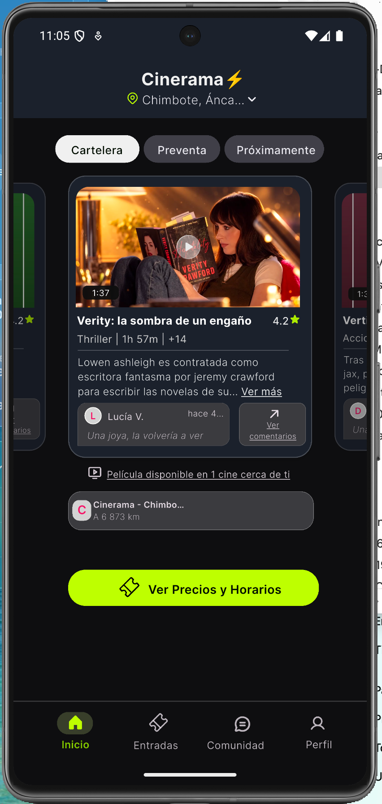
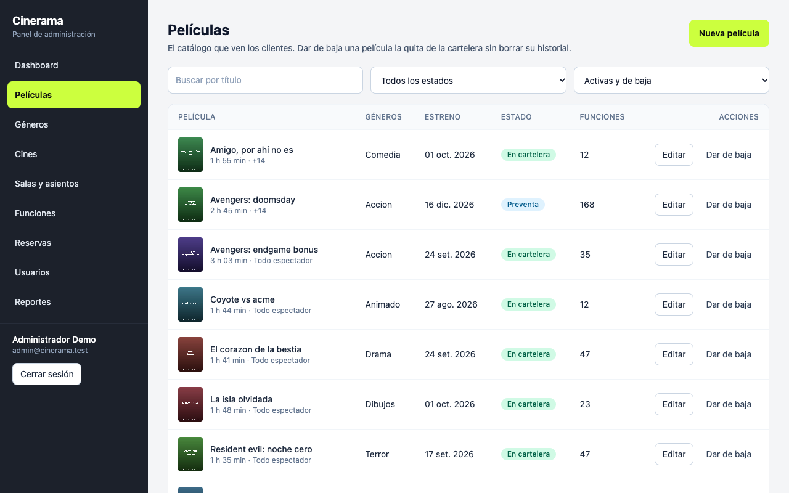
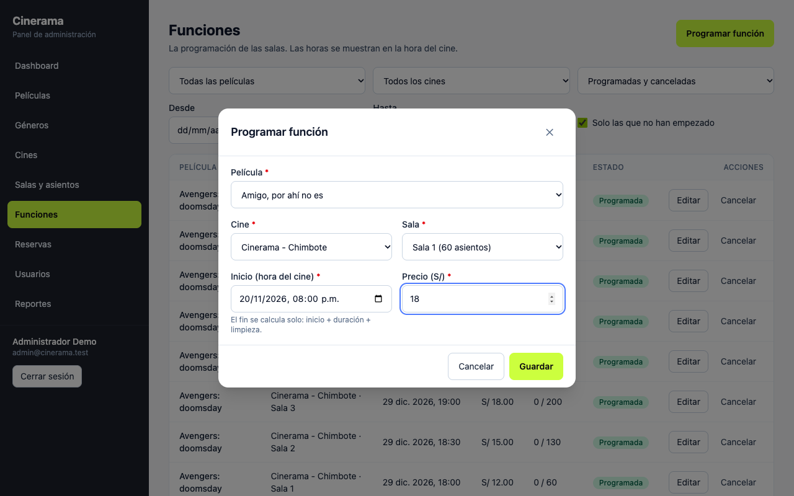
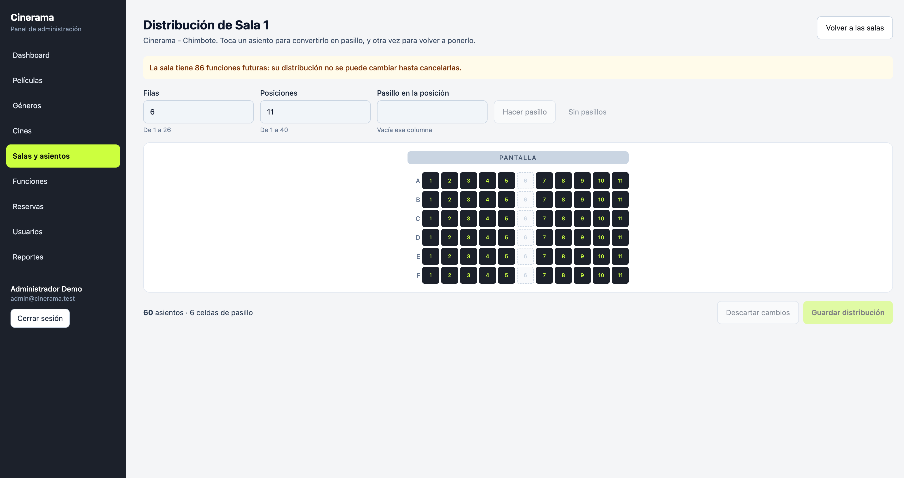
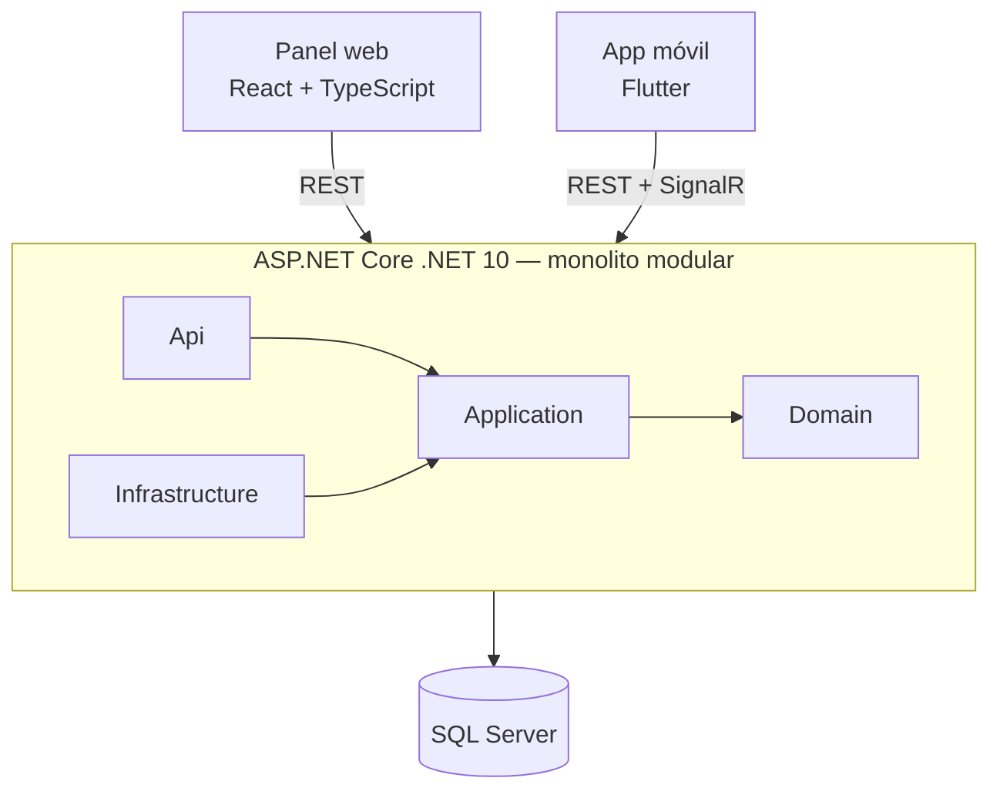

# Cinerama

Sistema full stack de reserva de entradas de cine: una **API en ASP.NET Core** que es la única fuente de verdad del estado de cada asiento, una **app móvil en Flutter** para los clientes y un **panel web en React** para administrar el cine.


> **Proyecto personal de portafolio.** Los usuarios, las reservas y los pagos son ficticios. Ver [Datos y aviso](#datos-y-aviso).

## Qué resuelve

Un cine con varias salas quiere vender entradas desde el celular **sin que un asiento se venda dos veces**, mostrar en tiempo real qué asientos quedan libres y saber cómo van las ventas y la ocupación. El proyecto cubre ese recorrido completo: cartelera, elección de asientos en vivo, reserva con ticket QR, y administración (catálogo, salas, funciones, reservas, usuarios y reportes).

## Qué demuestra este proyecto

| Tema | Cómo se aborda |
|---|---|
| **Concurrencia** | Sin doble venta: transacciones, concurrencia optimista (`RowVersion`), índice único filtrado y un límite por usuario, todo sobre SQL Server. Pruebas que lanzan N solicitudes simultáneas contra el mismo asiento, y 2 y 8 administradores programando a la vez en la misma sala ([ADR-004](docs/adr/ADR-004-seat-concurrency-strategy.md)) |
| **Estado que caduca** | Bloqueo temporal de 5 minutos con expiración en dos niveles: es correcto aunque el proceso en segundo plano no corra ([ADR-005](docs/adr/ADR-005-seat-lock-expiration.md)) |
| **Tiempo real** | Hub de SignalR que solo avisa (sin datos de quién bloqueó), con avisos después del commit ([ADR-016](docs/adr/ADR-016-signalr-realtime.md)) |
| **Seguridad** | Seguro por defecto, roles, identidad solo desde el token, refresh tokens con hash, rotación y detección de reutilización, cookie `HttpOnly` en el panel, rate limiting y configuración insegura vetada en producción ([ADR-006](docs/adr/ADR-006-web-session-cookies.md), [ADR-007](docs/adr/ADR-007-refresh-token-rotation.md)) |
| **SQL** | T-SQL con vistas, procedimientos almacenados, índices filtrados, restricciones `CHECK`, candados de aplicación (`sp_getapplock`) y migraciones versionadas; criterio explícito de cuándo usar un procedimiento y cuándo no ([ADR-009](docs/adr/ADR-009-stored-procedures-criteria.md)); reportes definidos una sola vez en `vw_ShowtimeSales` y `sp_GetSalesSummary` |
| **Integridad transaccional** | Operaciones que no pueden duplicarse ni quedar a medias: confirmación idempotente con `Idempotency-Key`, todo o nada al bloquear varios asientos, cancelación que libera asientos y avisa después del commit. Es el mismo tipo de problema de los sistemas de pagos y de banca |
| **Pruebas** | 662 pruebas del backend contra un SQL Server real y efímero (Testcontainers), 68 del panel, pruebas de widgets y de BLoC en la app. Se comprobó con mutaciones que las pruebas detectan fallos reales |
| **Entrega incremental y DevOps** | Trabajo por fases con criterios de salida y una definición de terminado ([roadmap](docs/roadmap.md)); Docker Compose para levantar todo con un comando, migraciones que se aplican al arrancar sin borrar datos y una orden de pruebas por componente |
| **Evolución y mantenimiento** | Cada requerimiento se traza hasta su regla, su caso de prueba y su prueba automatizada ([matriz](docs/testing/traceability-matrix.md)); los defectos hallados en una verificación real se documentan, se corrigen y quedan cubiertos por una prueba ([fase 4](docs/testing/phase-4-verification.md)) |
| **Documentación** | Requerimientos, historias con criterios Gherkin, reglas de negocio (RN-01 a RN-60), 18 ADRs, casos de prueba y matriz de trazabilidad |
| **Accesibilidad** | Diálogos con foco atrapado, errores conectados a su campo, mapa de asientos y editor de salas manejables con teclado |

## Capturas

<p align="center">
  
</p>
<p align="center"><em>App móvil: la cartelera se ve sin iniciar sesión</em></p>

| Panel: películas | Panel: programar una función |
|---|---|
|  |  |



*Editor de la distribución de asientos: con funciones futuras programadas, la distribución queda bloqueada (aviso amarillo).*

> La app móvil se describe en [mobile/README.md](mobile/README.md) y el panel en [web/README.md](web/README.md).

## Arquitectura



Monolito modular en cuatro capas (`Domain`, `Application`, `Infrastructure`, `Api`) sin MediatR, AutoMapper ni repositorios genéricos ([ADR-011](docs/adr/ADR-011-no-mediatr-automapper-repository.md)). El panel no tiene lógica de negocio: toda regla se aplica en la API ([ADR-018](docs/adr/ADR-018-admin-panel.md)). Detalle en [docs/architecture.md](docs/architecture.md).

## Stack

| Capa | Tecnologías |
|---|---|
| Backend | C#, .NET 10 LTS, ASP.NET Core Web API, EF Core, FluentValidation, SignalR, `BackgroundService` |
| Datos | SQL Server (T-SQL, vistas, stored procedures, índices filtrados) |
| Panel web | React 19, TypeScript, Vite, React Router, Axios, TanStack Query, React Hook Form + Zod, Tailwind, Recharts |
| Móvil | Flutter, Dart, BLoC, Dio, Drift, flutter_secure_storage |
| Pruebas | xUnit, WebApplicationFactory, Testcontainers, Vitest, Testing Library, MSW, `bloc_test` |
| Infraestructura | Docker, Docker Compose |

El motivo de cada tecnología, y cuáles se incluyen por valor de portafolio y no por necesidad del producto, está en [docs/tech-stack.md](docs/tech-stack.md).

## Qué hay implementado

### API

| Área | Contenido |
|---|---|
| Autenticación | Registro, login, refresh con rotación y detección de reutilización, logout, cookie `HttpOnly` para el panel |
| Autorización | Todo exige sesión salvo lo marcado como público; política `AdminOnly`; la identidad sale solo del token |
| Catálogo | Películas, géneros, cines y ciudades; **estado de estreno derivado** (cartelera, preventa, próximamente); opiniones con calificación promedio; imágenes servidas desde `/media`; tráiler de YouTube y sus comentarios ([ADR-017](docs/adr/ADR-017-catalog-release-cinemas-reviews.md)) |
| Asientos | Mapa de la función, bloqueo de 5 minutos (todo o nada), liberación y recomendación de asientos contiguos |
| Reservas | Confirmación idempotente (`Idempotency-Key`), ticket con QR firmado, listado, detalle y cancelación (2 h antes para el cliente, hasta el inicio para el administrador) |
| Administración | Altas, ediciones y bajas de películas, géneros, cines, salas (con su distribución de asientos) y funciones; listado de reservas y de usuarios con filtros; activar y desactivar cuentas |
| Reportes | KPIs del periodo, ventas por día y por película, ocupación por función y por sala |
| Plataforma | ProblemDetails con `code` estable, rate limiting, CORS con credenciales, configuración validada al arrancar, Swagger, `/health` |

### Panel de administración (`web/`)

Login con cookie `HttpOnly` y access token solo en memoria; dashboard del día; películas (con géneros, tráiler y medios), géneros, cines, salas con **editor de distribución accesible por teclado**, funciones (la hora se escribe en la hora del cine, no en la del navegador), reservas, usuarios y reportes con gráficos y tablas. Estados de carga, error, vacío y confirmación en todas las pantallas. Ver [web/README.md](web/README.md).

### App móvil (`mobile/`)

Flutter + BLoC: **cartelera sin iniciar sesión** (carrusel de tarjetas, pestañas, ciudad, calificaciones y distancia a los cines desde tu ubicación, que nunca sale del dispositivo), funciones, **mapa de asientos en vivo** y accesible, bloqueo con cuenta regresiva, confirmación idempotente, ticket con QR que se sigue viendo sin conexión, opiniones y tráiler de YouTube. Ver [mobile/README.md](mobile/README.md).

## Cómo ejecutarlo

Requisitos: Docker con Compose; para el panel, Node 22 o superior; para probar el backend fuera de un contenedor, el SDK de .NET 10; para la app, Flutter.

> **macOS con Apple Silicon:** SQL Server solo existe para x86 y corre emulado. Con Docker Desktop, activa *Use Rosetta for x86/amd64 emulation*. Con Colima: `colima start --vm-type vz --vz-rosetta --cpu 4 --memory 6`.

### 1. La API y la base de datos

```bash
cp .env.example .env        # y reemplaza los valores (contraseñas y claves)
docker compose up --build
```

| | |
|---|---|
| API | http://localhost:8090 (cambia el puerto con `API_PORT` en `.env`) |
| Swagger | http://localhost:8090/swagger |
| Salud | http://localhost:8090/health |
| Cuentas demo | `admin@cinerama.test` y `cliente1@cinerama.test` … `cliente20@cinerama.test`; las contraseñas son `SEED__ADMINPASSWORD` y `SEED__CUSTOMERPASSWORD` de tu `.env` |

El primer arranque descarga SQL Server, aplica las migraciones y carga los datos de demostración (9 películas, 1 cine con 7 salas y 728 asientos, unas 490 funciones, 114 opiniones y 21 cuentas). Las migraciones no borran datos existentes. `docker compose down -v` borra la base.

### 2. El panel web

```bash
cd web
cp .env.example .env
npm install
npm run dev                  # http://localhost:5173, entra con admin@cinerama.test
```

Abre el panel con `localhost` (no con `127.0.0.1`): el CORS y la cookie de sesión están configurados para ese origen.

### 3. La app móvil

```bash
cd mobile
flutter pub get
flutter run --profile --dart-define=API_BASE_URL=http://10.0.2.2:8090   # emulador de Android
```

`--profile` y no `--release`: Android bloquea el tráfico `http` sin cifrar en release y la API local no tiene HTTPS. Más en [mobile/README.md](mobile/README.md).

### API sin contenedor (solo SQL Server en Docker)

```bash
docker compose up -d sqlserver
cd backend/src/Cinerama.Api
dotnet user-secrets set "ConnectionStrings:Default" "Server=localhost,1433;Database=CineramaDev;User Id=sa;Password=<MSSQL_SA_PASSWORD>;TrustServerCertificate=True"
dotnet user-secrets set "Jwt:SigningKey" "<al menos 32 caracteres aleatorios>"
dotnet user-secrets set "Ticket:SigningKey" "<otros 32 caracteres aleatorios, distintos de los de JWT>"
dotnet user-secrets set "Seed:AdminPassword" "<contraseña demo>"
dotnet user-secrets set "Seed:CustomerPassword" "<contraseña demo>"
dotnet run --launch-profile http     # http://localhost:5080/swagger
```

## Configuración

Todas las variables están en [.env.example](.env.example); `.env` nunca se versiona.

| Variable | Para qué |
|---|---|
| `MSSQL_SA_PASSWORD`, `CINERAMA_DB_NAME` | Contraseña y nombre de la base de SQL Server |
| `JWT__SIGNINGKEY` | Clave de los tokens (mínimo 32 caracteres aleatorios) |
| `TICKET__SIGNINGKEY` | Clave HMAC que firma el QR del ticket (distinta de la anterior) |
| `CORS__ALLOWEDORIGINS` | Orígenes del panel separados por coma; nunca `*`, porque se usan credenciales |
| `SEED__ADMINPASSWORD`, `SEED__CUSTOMERPASSWORD` | Contraseñas de las cuentas demo |
| `YOUTUBE__APIKEY` | Opcional. Clave de la API de datos de YouTube v3 para los comentarios del tráiler; vive solo en el servidor. Sin ella esa sección se oculta |

La API se niega a arrancar con configuración inválida, y en producción se vetan los valores inseguros de desarrollo (por ejemplo, la cookie de sesión sin `Secure`).

## Pruebas

```bash
# Backend: 188 unitarias + 474 de integración
export DOCKER_HOST="unix://$HOME/.colima/default/docker.sock"             # solo con Colima
export TESTCONTAINERS_DOCKER_SOCKET_OVERRIDE=/var/run/docker.sock         # solo con Colima
cd backend && dotnet test Cinerama.sln

# Panel: 68 pruebas + comprobación de tipos y build de producción
cd web && npm test && npm run build

# App móvil
cd mobile && flutter analyze && flutter test
```

Las pruebas de integración levantan su propio SQL Server con Testcontainers y necesitan Docker.

Además de las pruebas automatizadas, el panel se verificó con un recorrido real —Chrome contra la API y SQL Server, sin simulaciones— que encontró y corrigió defectos: [docs/testing/phase-4-verification.md](docs/testing/phase-4-verification.md).

## Documentación

| Documento | Contenido |
|---|---|
| [Requerimientos](docs/requirements.md) | Contexto, actores, requerimientos funcionales y no funcionales, fuera de alcance |
| [Historias de usuario](docs/user-stories.md) | Épicas e historias con criterios de aceptación en Gherkin |
| [Casos de uso](docs/use-cases.md) | Flujos principales y alternativos |
| [Reglas de negocio](docs/business-rules.md) | RN-01 a RN-60 |
| [Diseño funcional](docs/functional-design.md) | Máquinas de estado, pantallas, accesibilidad, KPIs |
| [Arquitectura](docs/architecture.md) | Capas, flujos críticos, despliegue, manejo de errores |
| [Base de datos](docs/database.md) | Modelo, restricciones, índices, vista y procedimientos |
| [API](docs/api.md) | Endpoints, convenciones, códigos de error, SignalR |
| [ADRs](docs/adr/README.md) | 18 decisiones de arquitectura |
| [Pruebas](docs/testing/test-plan.md) | Plan, [casos](docs/testing/test-cases.md), [trazabilidad](docs/testing/traceability-matrix.md) y [verificación de la fase 4](docs/testing/phase-4-verification.md) |
| [Roadmap](docs/roadmap.md) | Fases, criterios de salida y definición de terminado |
| [Stack](docs/tech-stack.md) | Por qué cada tecnología y cuáles se descartaron |
| [Cobertura de datos](docs/ui-data-coverage.md) | De dónde sale cada elemento de la pantalla de inicio y dónde está en la base |
| [Interfaz móvil](docs/ui-figma.md) | Cómo se construye la interfaz a partir del diseño |

## Estructura del repositorio

```
cinerama/
├── backend/
│   ├── src/        # Cinerama.Domain, .Application, .Infrastructure, .Api
│   ├── tests/      # Cinerama.UnitTests, Cinerama.IntegrationTests
│   ├── tools/      # importador de la cartelera de demostración
│   └── Dockerfile
├── web/            # Panel de administración (React + TypeScript + Vite)
├── mobile/         # App móvil (Flutter)
├── docs/           # documentación funcional y técnica, ADRs, pruebas
├── docker-compose.yml
└── .env.example
```

## Datos y aviso

Los usuarios, las reservas y los pagos son ficticios. La cartelera de demostración reproduce títulos, sinopsis y programación de carácter público de un cine real para que la pantalla de inicio se vea creíble; los pósters son marcadores generados para el proyecto. Los tráileres se reproducen con el reproductor oficial de YouTube y los comentarios se muestran como una fuente separada, con su atribución.

El panel guarda la *ruta* del póster, del video corto y del logo, y no sube archivos. El video corto de la demostración no se versiona (es un fragmento de una película real): sin él, la app muestra el póster.

Este proyecto no tiene relación con ninguna empresa de cine ni cuenta con su respaldo; «Cinerama» es solo el nombre del proyecto. Las marcas y los títulos mencionados pertenecen a sus titulares.

## Licencia y autoría

© 2026 Larry Bryan Quiroz Flores. **Todos los derechos reservados.** El código se publica solo para que pueda leerse y evaluarse; no se concede permiso para copiarlo, modificarlo, distribuirlo ni usarlo sin autorización escrita del autor. Ver [LICENSE](LICENSE).
