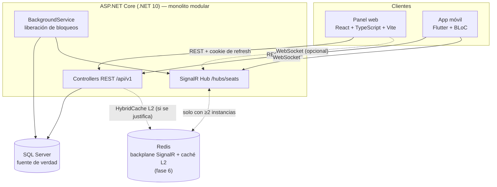
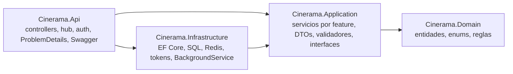
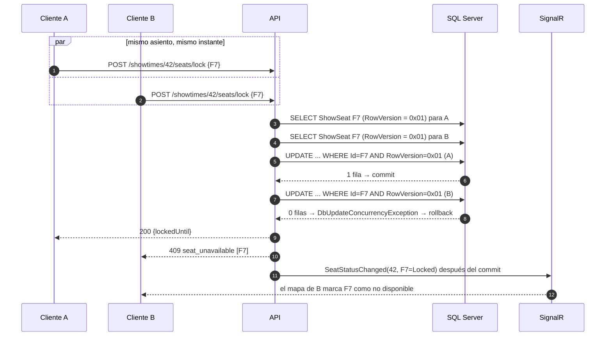
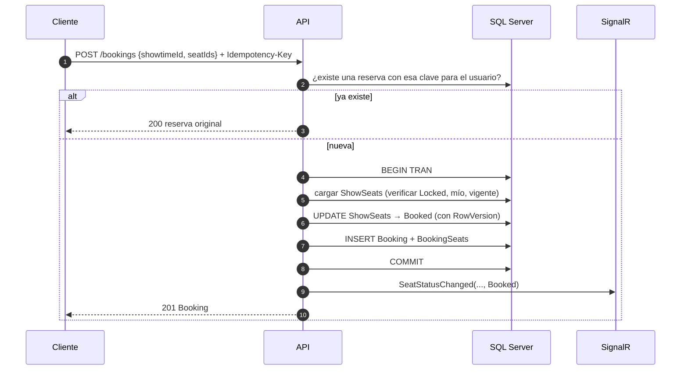
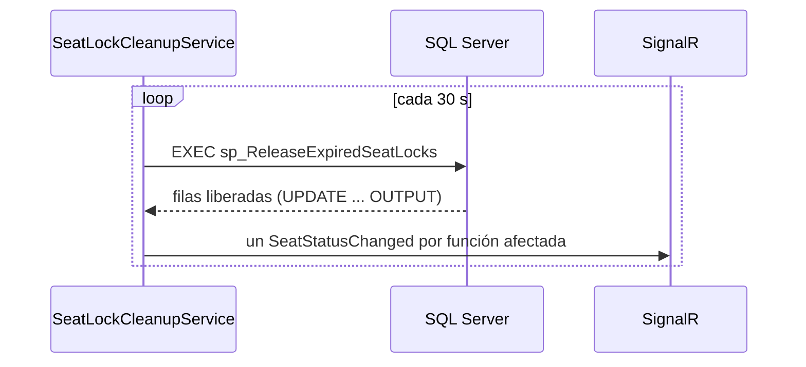
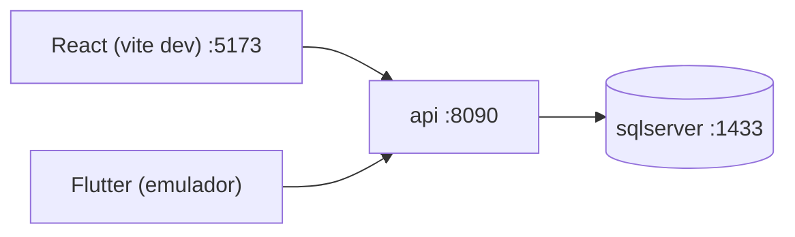
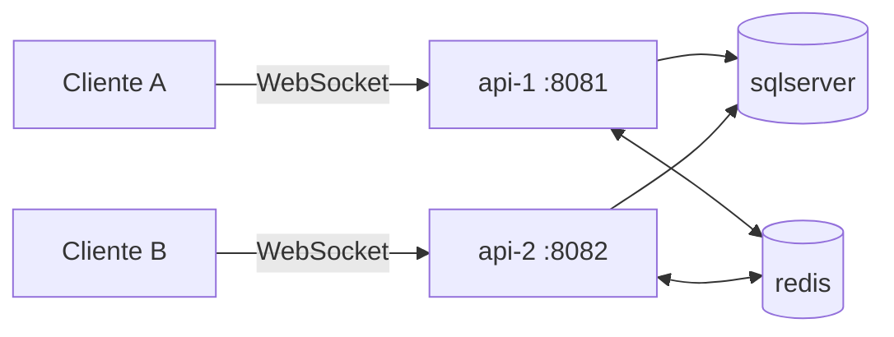

# Arquitectura

## 1. Vista general



**Principio rector:** SQL Server es la única fuente de verdad del estado de los asientos. SignalR y Redis solo **comunican** cambios que ya se confirmaron en la base. Si fallan, ningún dato se corrompe: lo único que se pierde es la inmediatez de la notificación.

## 2. Capas del backend



| Proyecto | Contiene | No contiene |
|---|---|---|
| Domain | Entidades con comportamiento (`ShowSeat.Lock()`, `ShowSeat.Confirm()`, `Booking.Cancel()`), enums y excepciones de dominio. | Referencias a EF Core o ASP.NET Core. |
| Application | Un servicio por caso de uso (`SeatLockService`, `BookingService`), DTOs, validadores (FluentValidation), `SeatRecommendationService` (lógica pura) e interfaces (`IAppDbContext`, `ISeatNotifier`, `ITokenService`). | Controllers, SQL escrito a mano, Redis. |
| Infrastructure | `CineramaDbContext`, configuraciones Fluent API, migraciones, archivos `.sql` (SPs y vistas), `TokenService`, `SeatLockCleanupService` y caché. | Reglas de negocio. |
| Api | Controllers delgados, `SeatHub`, `SignalRSeatNotifier`, políticas de autorización, manejo global de errores, rate limiting, CORS y Swagger. | Lógica de negocio. |

**Organización interna por feature**: dentro de Application e Infrastructure el código se agrupa por módulo, no por tipo técnico:

```
Application/
├── Auth/          (AuthService, DTOs, validadores)
├── Catalog/       (películas y géneros)
├── Rooms/         (salas y layout)
├── Showtimes/
├── Seating/       (mapa, bloqueo, liberación, recomendación)
├── Bookings/
├── Reports/
└── Common/        (paginación, errores, interfaces compartidas)
```

**Compromiso consciente:** Application depende del paquete de EF Core a través de `IAppDbContext`, para usar LINQ y proyecciones sin una capa de repositorio intermedia. Ver [ADR-011](adr/ADR-011-no-mediatr-automapper-repository.md).

## 3. Flujos críticos

### 3.1 Bloqueo de asientos con concurrencia



Hay tres barreras independientes contra la doble venta (detalle en [ADR-004](adr/ADR-004-seat-concurrency-strategy.md)):

1. **Concurrencia optimista con `RowVersion`** al bloquear y al confirmar.
2. **Transacción** que hace que una operación con varios asientos sea todo o nada.
3. **Índice único filtrado** en `BookingSeats(ShowSeatId) WHERE ReleasedAt IS NULL`, que rechaza en la base una segunda reserva activa aunque la aplicación tuviera un error.

### 3.2 Confirmación



### 3.3 Liberación de bloqueos vencidos



El `BackgroundService` es un singleton y el `DbContext` es *scoped*, así que el servicio crea un scope por ciclo con `IServiceScopeFactory`. El reloj se inyecta con `TimeProvider` para poder probar la expiración sin esperar 5 minutos.

## 4. Despliegue local

### Una instancia (fases 1–5)



### Dos instancias (fase 6)



La demostración conecta a cada cliente **directamente** a una instancia distinta. Así queda a la vista que, sin backplane, el cliente B no se entera de un bloqueo hecho en la instancia 1, y que con Redis sí. No hace falta un balanceador ni sesiones persistentes (*sticky sessions*). Ver [ADR-008](adr/ADR-008-redis-usage.md).

## 5. Manejo de errores

Todos los errores se devuelven como `application/problem+json` (RFC 9457):

```json
{
  "type": "https://cinerama.example/errors/seat-unavailable",
  "title": "Uno o más asientos no están disponibles",
  "status": 409,
  "code": "seat_unavailable",
  "traceId": "00-4bf9...-01",
  "conflicts": [{ "seatId": 1234, "label": "F7" }]
}
```

| Origen | Código HTTP |
|---|---|
| Validación de formato (FluentValidation) | 400 con `errors` por campo |
| Sin token, token inválido o vencido | 401 (`token_expired` cuando aplica) |
| Rol insuficiente | 403 |
| No existe, o no es del usuario | 404 |
| `DbUpdateConcurrencyException`, violación de índice único, conflicto de estado | 409 |
| Regla de negocio (`DomainRuleException`) | 422 |
| Rate limit | 429 |
| Excepción no controlada | 500 con `traceId`, sin stack trace |

Las excepciones de dominio llevan el `code` estable. El manejador global (`IExceptionHandler`) las traduce a HTTP en un único lugar.

## 6. Justificación del stack

Cada tecnología y su motivo están en [tech-stack.md](tech-stack.md). Las decisiones con alternativas reales están en [`adr/`](adr/).
