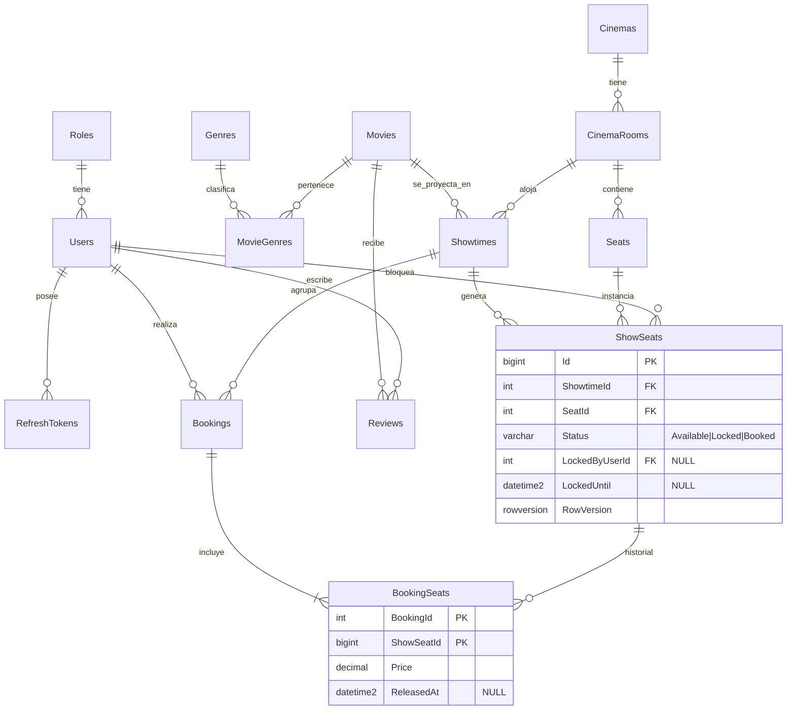

# Base de datos (SQL Server)

> Diseño de la fase 0. Los nombres finales de índices y constraints se fijan en las migraciones de la fase 1. Si cambian, este documento se actualiza en el mismo PR.

## 1. Modelo entidad-relación



## 2. Tablas

Convenciones:

- Fechas en `datetime2(3)` y siempre en UTC (RN-38).
- Importes en `decimal(10,2)`.
- Estados en `varchar(10)` con `CHECK`, en lugar de enteros, para que se lean bien en SQL y en herramientas de BI.
- Columnas de auditoría `CreatedAt` y `UpdatedAt` en las tablas que se editan.

| Tabla | Columnas | Constraints e índices | Por qué |
|---|---|---|---|
| **Roles** | Id `tinyint`, Name | UX `Name`. Seed: Admin y Customer. | Catálogo de roles con integridad referencial. Con 2 roles y un rol por usuario no hace falta una tabla intermedia. |
| **Users** | Id `int`, Email `nvarchar(256)`, PasswordHash, FullName, **AvatarUrl** NULL, RoleId, IsActive, CreatedAt | UX `Email`, FK `RoleId` | El email se guarda ya normalizado, así el índice único aplica RN-01 sin funciones en la consulta. |
| **RefreshTokens** | Id, UserId, TokenHash `binary(32)`, FamilyId `uniqueidentifier`, ExpiresAt, CreatedAt, RevokedAt, ReplacedById | UX `TokenHash`, IX `UserId`, IX `FamilyId` | Se guarda el hash, nunca el token. `FamilyId` agrupa la cadena de rotación para revocarla entera si se detecta reutilización (RN-05). |
| **Genres** | Id, Name | UX `Name` | |
| **Movies** | Id, Title, Synopsis, DurationMinutes, Classification, PosterUrl, **TrailerUrl, PreviewVideoUrl, ReleaseDate `date`, PreSaleStartsOn `date` NULL**, IsActive, CreatedAt, UpdatedAt | CHECK `DurationMinutes BETWEEN 1 AND 400`, **CHECK `PreSaleStartsOn IS NULL OR PreSaleStartsOn <= ReleaseDate`**, IX `(IsActive, Title)` | El índice cubre el listado de cartelera filtrado por activas y ordenado por título. Las dos fechas definen el estado de estreno (RN-41): el estado **se deriva, no se guarda**, así que no puede quedar desactualizado. `PreviewVideoUrl` es el video corto (`.mp4`) del detalle. `PosterUrl`, `TrailerUrl` y `PreviewVideoUrl` guardan una ruta relativa a la carpeta de medios o una URL absoluta (RN-48). |
| **Reviews** | Id, MovieId, UserId, Rating `tinyint`, Comment `nvarchar(500)` NULL, CreatedAt, UpdatedAt | CHECK `Rating BETWEEN 1 AND 5`, **UX `(MovieId, UserId)`**, **IX `(MovieId, CreatedAt DESC) INCLUDE (Rating)`**, FK a `Movies` y `Users` (`Cascade`) | El índice único aplica RN-43 en la base y es la barrera si dos solicitudes compiten. El otro índice sirve el promedio, la cantidad y las últimas opiniones de una película sin leer la tabla. El promedio **se calcula al consultar** (no hay una columna desnormalizada que pueda desincronizarse; si la medición de la fase 6 lo pide, se cambia). |
| **MovieGenres** | MovieId, GenreId | PK `(MovieId, GenreId)` | Relación muchos a muchos. En EF Core se mapea como *skip navigation*. |
| **Cinemas** | Id, Name, Address, City, Region, Latitude `decimal(9,6)`, Longitude, LogoUrl, IsActive | UX `Name`, CHECK latitud en `[-90, 90]` y longitud en `[-180, 180]`, IX `(IsActive, City)` | Una sede. El índice cubre el selector de ciudades y el filtro por ciudad. La ciudad es una columna y no una tabla: con un puñado de sedes no justifica otra tabla (se normaliza si aparece administración de ciudades). |
| **CinemaRooms** | Id, **CinemaId**, Name, IsActive | **UX `(CinemaId, Name)`**, FK `CinemaId` (`Restrict`) | El nombre es único dentro de su cine: "Sala 1" existe en cada sede. |
| **Seats** | Id, CinemaRoomId, RowLabel `char(1)`, Number `tinyint`, IsActive | UX `(CinemaRoomId, RowLabel, Number)`, CHECK `RowLabel BETWEEN 'A' AND 'Z'` | `Number` es la posición física en la fila. Un número faltante es un pasillo, y eso permite que la recomendación detecte cortes de contigüidad. |
| **Showtimes** | Id, MovieId, CinemaRoomId, StartsAt, EndsAt, Price, Status, CreatedAt | CHECK `EndsAt > StartsAt`, CHECK `Price >= 0`, CHECK `Status IN ('Scheduled','Cancelled')`, IX `(CinemaRoomId, StartsAt) INCLUDE (EndsAt, Status)`, IX `(MovieId, StartsAt)` | El primer índice sirve para la validación de solapamiento (RN-13) y el segundo para "funciones de esta película". |
| **ShowSeats** | Id `bigint`, ShowtimeId, SeatId, Status, LockedByUserId, LockedUntil, RowVersion | UX `(ShowtimeId, SeatId)`, CHECK de coherencia (ver abajo), IX filtrado `(LockedUntil) WHERE Status = 'Locked'` | Es la tabla central. El índice filtrado hace que la limpieza solo recorra los bloqueos activos, no todos los asientos históricos. |
| **Bookings** | Id, Code `char(8)`, UserId, ShowtimeId, Status, TotalAmount, IdempotencyKey `nvarchar(64)`, CreatedAt, CancelledAt | UX `Code`, UX filtrado `(UserId, IdempotencyKey) WHERE IdempotencyKey IS NOT NULL`, IX `(UserId, CreatedAt DESC)`, CHECK `Status IN ('Confirmed','Cancelled')` | El índice por usuario y fecha cubre "Mis reservas" y aplica el filtro de dueño (RN-32). |
| **BookingSeats** | BookingId, ShowSeatId, Price, ReleasedAt | PK `(BookingId, ShowSeatId)`, **UX filtrado `(ShowSeatId) WHERE ReleasedAt IS NULL`** | Precio copiado al confirmar (RN-25). El índice filtrado garantiza RN-31 en la base. |

### CHECK de coherencia en ShowSeats

```sql
CONSTRAINT CK_ShowSeats_LockConsistency CHECK (
       (Status = 'Available' AND LockedByUserId IS NULL     AND LockedUntil IS NULL)
    OR (Status = 'Locked'    AND LockedByUserId IS NOT NULL AND LockedUntil IS NOT NULL)
    OR (Status = 'Booked'    AND LockedByUserId IS NULL     AND LockedUntil IS NULL)
)
```

Con esta restricción, un error en el código no puede dejar un asiento "bloqueado sin dueño" ni "disponible con fecha de vencimiento".

### ¿Por qué `LockedUntil` y no `LockedAt`?

- La condición de vencimiento queda `LockedUntil < SYSUTCDATETIME()` y no depende de la duración del bloqueo.
- Cambiar el TTL de 5 minutos no requiere tocar el SQL.
- El índice filtrado sobre `LockedUntil` se usa directamente.

### Migración posterior (`AddMoviePreviewVideo`)

Agrega `Movies.PreviewVideoUrl` (nullable): no toca datos existentes.

### Migración de la fase 3.5 (`AddReleaseCinemasAndReviews`)

Una base que ya tenía datos se actualiza sin perderlos: las películas existentes quedan "estrenadas" el día en que se crearon, y si ya había salas se crea el cine **Cinerama - Chimbote** y todas pasan a ser suyas. Una base vacía no recibe cines: los crea el seed.

## 3. Concurrencia y nivel de aislamiento

- **Nivel por defecto:** `READ COMMITTED` con bloqueos, que es el valor predeterminado de SQL Server. No se activa `READ_COMMITTED_SNAPSHOT`, para que el comportamiento de las actualizaciones concurrentes sea el documentado y el que verifican los tests. Si en el futuro se activa, los tests de concurrencia son el control de regresión.
- **`RowVersion`** (`rowversion`, configurado con `.IsRowVersion()` en EF Core): SQL Server lo incrementa automáticamente en cada `UPDATE`. EF Core lo incluye en el `WHERE` y, si la fila cambió, lanza `DbUpdateConcurrencyException`.
- **Programar funciones** usa `IsolationLevel.Serializable`. La consulta de solapamiento toma *range locks* sobre el índice `(CinemaRoomId, StartsAt)`, así que dos administradores no pueden insertar funciones solapadas al mismo tiempo (RN-13). Es la única operación que lo necesita, y por eso no se usa como nivel global.
- **Lock de aplicación por usuario y función** (`sp_getapplock`, modo `Transaction`): serializa las solicitudes de bloqueo de una misma persona sobre una misma función para que el límite de 10 asientos (RN-20) no se pueda superar con solicitudes simultáneas. Dura lo que la transacción y no afecta a otros usuarios. Ver ADR-004.
- **Orden de carga:** los asientos se cargan siempre ordenados por `SeatId`, así dos solicitudes con asientos en común actualizan en el mismo orden y no se interbloquean.
- **Reintentos:** si se habilita `EnableRetryOnFailure`, las transacciones explícitas deben envolverse en `CreateExecutionStrategy().ExecuteAsync(...)`. Es una trampa conocida de EF Core con SQL Server y está documentada en el código.

## 4. Stored procedures y vistas

Criterio ([ADR-009](adr/ADR-009-stored-procedures-criteria.md)): un SP o una vista existe **solo** cuando aporta algo que EF Core no resuelve bien, como atomicidad con resultado, una agregación reutilizable fuera de la API o un plan de ejecución que conviene afinar en SQL.

### `sp_ReleaseExpiredSeatLocks`  *(implementado: migración `AddSeatLockCleanupProcedure`)*

| | |
|---|---|
| **Problema** | Liberar los bloqueos vencidos y saber **cuáles** se liberaron, para notificarlos. |
| **Parámetros** | `@NowUtc datetime2(3)`, `@BatchSize int = 500` |
| **Resultado** | `ShowtimeId, ShowSeatId, SeatId` de cada asiento liberado |
| **Por qué un SP** | `ExecuteUpdateAsync` de EF Core devuelve solo la cantidad de filas. Hacer `SELECT` y luego `UPDATE` abre una carrera entre las dos sentencias: otro cliente podría bloquear el asiento entre ambas y recibir un aviso de "disponible" falso. `UPDATE ... OUTPUT` es atómico y devuelve las filas en una sola ida a la base. Con dos instancias de la API ejecutándolo a la vez, cada fila la libera una sola. |
| **Por qué `@NowUtc` y no `SYSUTCDATETIME()`** | La aplicación y la base usan **un solo reloj** (el `TimeProvider` de la aplicación), y las pruebas pueden adelantar el tiempo sin esperar 5 minutos. |

El archivo está en `Infrastructure/Persistence/Sql/sp_ReleaseExpiredSeatLocks.sql` y el criterio de vencimiento (`LockedUntil <= @NowUtc`) es el mismo que usa el dominio (`ShowSeat.IsExpired`).

```sql
UPDATE TOP (@BatchSize) dbo.ShowSeats
SET    Status = 'Available', LockedByUserId = NULL, LockedUntil = NULL
OUTPUT inserted.ShowtimeId, inserted.Id AS ShowSeatId, inserted.SeatId AS SeatId
WHERE  Status = 'Locked' AND LockedUntil <= @NowUtc;
```

Libera de a 500 filas; quien lo llama repite mientras el lote venga lleno (un test libera 600).

### `vw_ShowtimeSales`

| | |
|---|---|
| **Problema** | Capacidad, vendidas, ocupación e ingresos por función, con la misma definición en todos los reportes. |
| **Columnas** | `ShowtimeId, MovieId, MovieTitle, CinemaId, CinemaName, CinemaRoomId, RoomName, StartsAt, Status, Capacity, SeatsSold, Revenue, Bookings, Occupancy` |
| **Qué cuenta** | Solo reservas `Confirmed` suman vendidas, ingresos y reservas (RN-37). `Capacity` es el total de asientos de la función. Una función cancelada aparece con `Status = 'Cancelled'` y los reportes la excluyen. Se crea y se elimina desde la migración `AddSalesReporting`, que lee el archivo `Persistence/Sql/vw_ShowtimeSales.sql`. |
| **Por qué una vista** | La definición de ocupación e ingresos (RN-36, RN-37) vive en un solo lugar. La API la consume como entidad *keyless* de EF Core (`ToView`), y la misma vista puede alimentar una herramienta de BI sin duplicar lógica. |

### `sp_GetSalesSummary`

| | |
|---|---|
| **Problema** | KPIs del dashboard para un rango de fechas. |
| **Parámetros** | `@FromUtc datetime2, @ToUtc datetime2` |
| **Resultado** | Una fila: `Revenue, Bookings, TicketsSold, AverageTicket, AverageOccupancy, Showtimes`. Solo cuentan funciones `Scheduled` con inicio en `[@FromUtc, @ToUtc)`: una función cancelada no vende y su capacidad no debe diluir la ocupación. La API traduce las fechas locales del cine (RN-57) a esos instantes UTC. Archivo: `Persistence/Sql/sp_GetSalesSummary.sql`. |
| **Por qué un SP** | Es una agregación de conjunto sobre varias tablas cuyo plan conviene revisar y afinar con `SET STATISTICS IO/TIME` (fase 6). **Motivación de portafolio:** podría escribirse en LINQ con un resultado equivalente. Se elige SP para mostrar T-SQL y análisis de planes, y está marcado así en ADR-009. |

### Descartados

| Candidato | Motivo |
|---|---|
| `sp_GetAvailableSeatsByShowtime` | Es una consulta trivial sobre el índice `(ShowtimeId, SeatId)`. Una proyección de EF Core con `AsNoTracking` es igual de eficiente y más mantenible. |
| `sp_GetRecommendedSeats` | Es lógica de negocio. En C# se prueba con xUnit sin base de datos; en T-SQL sería más difícil de probar y de leer. |
| `sp_CreateShowtime` | La validación de solapamiento y la generación de asientos se resuelven en C# con una transacción serializable y un `INSERT ... SELECT`. Moverlas a SQL partiría las reglas de negocio en dos lugares. |

> **SQL manual:** la tabla `ShowSeats` tiene índices filtrados, que exigen `QUOTED_IDENTIFIER ON`. EF Core y la API ya lo usan; `sqlcmd` lo trae apagado por defecto, así que para modificar datos a mano hay que ejecutarlo con la opción `-I` (o `SET QUOTED_IDENTIFIER ON;`). Sin ella, el `UPDATE` falla con el error 1934.

### Versionado

Los archivos `.sql` viven en `Infrastructure/Persistence/Sql/` y se aplican desde las migraciones con `migrationBuilder.Sql(...)`. Así un SP o una vista cambia junto con el esquema, queda en el historial de Git y se despliega igual en cada entorno.

## 5. Estrategia de consultas (EF Core)

| Práctica | Dónde |
|---|---|
| `AsNoTracking` + proyección a DTO con `Select` | Todas las lecturas |
| Paginación con `Skip`/`Take`, orden estable y total con `CountAsync` | Listados del admin y cartelera |
| Una consulta por pantalla (sin N+1): la cartelera proyecta los géneros dentro del mismo `Select` | Catálogo |
| Entidades con tracking + `RowVersion` | Bloqueo, liberación, confirmación y cancelación: todas las transiciones de un asiento |
| `ExecuteUpdateAsync` | Revocar refresh tokens |
| `INSERT ... SELECT` mediante `ExecuteSqlInterpolatedAsync` | Generar los ShowSeats de una función nueva en una sola sentencia |
| Logging de SQL en desarrollo | Para detectar N+1 y consultas no esperadas |

Las mejoras de rendimiento se documentan en `docs/performance.md` (fase 6) con el formato problema → medición inicial → cambio → medición final, y solo con números medidos.
