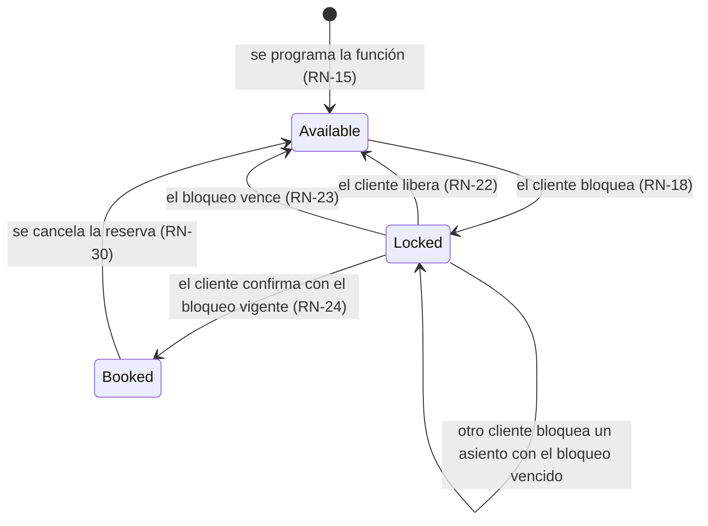
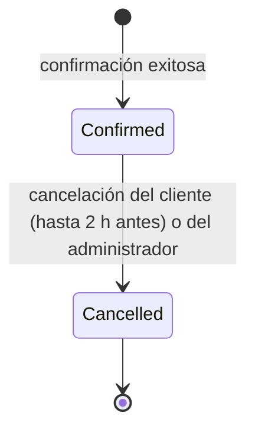
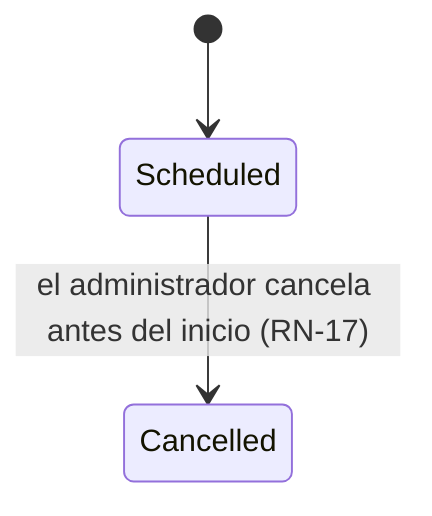
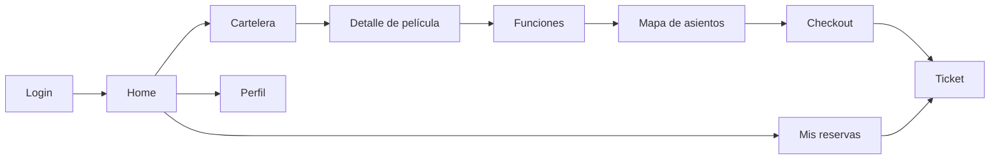

# Diseño funcional

Describe **cómo se comporta** el producto: estados, pantallas, mensajes y definiciones de indicadores. El *qué* está en [requirements.md](requirements.md) y el *cómo está construido* en [architecture.md](architecture.md).

## 1. Máquinas de estado

### Asiento de función (`ShowSeat`)

`Selected` **no es un estado del servidor**. Es la forma en que la app muestra un asiento `Locked` cuyo dueño es el propio usuario (campo `isMine` en la respuesta).

### Reserva (`Booking`)

No existe un estado `Pending`. El periodo "pendiente de pago" lo representa el bloqueo del asiento, así la reserva nunca queda a medias.

### Función (`Showtime`)

"En curso" y "finalizada" no se guardan como estados: se derivan de `StartsAt` y `EndsAt` comparados con la hora actual.

## 2. App móvil (cliente)

| Pantalla | Contenido | Sin conexión |
|---|---|---|
| Login / Registro | Formularios con validación en el cliente que replica RN-01 y RN-02. | Requiere conexión |
| Home | Próxima reserva y accesos rápidos. | Datos en caché |
| Cartelera | Lista paginada con búsqueda y filtro por género. | Caché + aviso "Actualizado hace X" |
| Detalle | Sinopsis, duración, clasificación y próximas funciones. | Caché (las funciones pueden estar desactualizadas, con aviso) |
| Mapa de asientos | Grilla con zoom y desplazamiento, leyenda, recomendación y cuenta regresiva. | **Requiere conexión** |
| Checkout | Resumen, total y botón "Confirmar (pago simulado)". | **Requiere conexión** |
| Mis reservas | Lista de reservas confirmadas y canceladas. | Caché |
| Ticket | QR, código, película, sala, asientos y hora. | Caché |
| Perfil | Nombre, email y cerrar sesión. | Lectura en caché |

### Mapa de asientos: representación accesible (RNF-13)

| Estado | Color | Forma / ícono | Etiqueta para lector de pantalla |
|---|---|---|---|
| Disponible | Verde contorno | Butaca vacía | "Fila F, asiento 7, disponible" |
| Seleccionado (mío) | Azul relleno | Butaca con ✓ | "Fila F, asiento 7, seleccionado por ti" |
| No disponible (bloqueado por otro) | Gris | Butaca con reloj | "Fila F, asiento 7, no disponible temporalmente" |
| Vendido | Gris oscuro | Butaca con ✕ | "Fila F, asiento 7, vendido" |
| Pasillo | — | Espacio vacío | No se anuncia |

Además:

- La pantalla del cine se dibuja en la parte superior, como referencia de orientación.
- Los asientos tienen un área táctil mínima de 44×44 pt, alcanzable con zoom.
- Cuando llega un evento en tiempo real, solo se repintan los asientos afectados; la grilla no se reconstruye.

## 3. Panel web (administrador)

| Pantalla | Funciones |
|---|---|
| Login | Solo usuarios `Admin`. Un `Customer` recibe "No tienes acceso al panel". |
| Dashboard | KPIs del periodo, ventas por día, top 5 películas y top 5 funciones por ocupación. |
| Películas | Tabla paginada con búsqueda, alta, edición y baja lógica. |
| Géneros | Lista con alta, edición y baja. |
| Salas | Lista, alta y edición del layout (grilla de filas por posiciones donde se marcan los pasillos). |
| Funciones | Calendario o lista por fecha, programación y cancelación. |
| Reservas | Tabla con filtros por fecha, película y estado, y cancelación administrativa. |
| Usuarios | Tabla, y activar o desactivar cuentas. |
| Reportes | Ventas por película y ocupación por sala, con un rango de fechas. |

## 4. Mensajes al usuario

Los mensajes se derivan del `code` de la respuesta, nunca del texto que devuelve el servidor. Así se pueden cambiar los textos sin tocar la API.

| `code` | Mensaje en la app |
|---|---|
| `seat_unavailable` | "Alguien tomó {asientos} hace un momento. Elige otros asientos." |
| `lock_expired` | "Tu selección expiró. Vuelve a elegir tus asientos." |
| `lock_limit_exceeded` | "Puedes seleccionar hasta 10 asientos por función." |
| `sales_closed` | "La venta para esta función ya cerró." |
| `cancellation_window_closed` | "Solo puedes cancelar hasta 2 horas antes de la función." |
| `token_expired` | (sin mensaje: renovación transparente) |
| `refresh_token_reused` | "Por seguridad cerramos tu sesión. Vuelve a iniciar sesión." |
| sin conexión | "Sin conexión. Puedes ver tus entradas guardadas." |

## 5. Definición de KPIs

Todas las métricas excluyen las reservas canceladas y usan la zona horaria del cine (RN-38).

| KPI | Fórmula | Fuente |
|---|---|---|
| Ingresos | Σ `BookingSeats.Price` de reservas `Confirmed` en el periodo | `sp_GetSalesSummary` |
| Reservas | Cantidad de reservas `Confirmed` creadas en el periodo | `sp_GetSalesSummary` |
| Entradas vendidas | Cantidad de asientos de esas reservas | `sp_GetSalesSummary` |
| Ticket promedio | Ingresos / reservas | `sp_GetSalesSummary` |
| Ocupación promedio | Σ asientos vendidos / Σ capacidad de las funciones **realizadas o programadas** del periodo (ponderada por capacidad) | `vw_ShowtimeSales` |
| Película más reservada | Mayor cantidad de entradas vendidas | `vw_ShowtimeSales` agrupada por película |
| Función con mayor ocupación | Mayor relación vendidos / capacidad | `vw_ShowtimeSales` |

**Decisión de definición:** las ventas se atribuyen al **día de la compra** y la ocupación al **día de la función**. Por eso las dos cifras de un mismo día pueden no coincidir, y el dashboard lo aclara en la ayuda contextual.

## 6. Datos semilla

Todos los datos son ficticios:

- **Películas:** títulos inventados (por ejemplo "La Última Proyección" o "Noche en el Puerto"). Los pósters son imágenes de marcador de posición.
- **Usuarios:** `admin@cinerama.test` y `cliente1..20@cinerama.test`. El dominio `.test` está reservado y nunca recibe correos reales.
- **Salas:** 3 salas de 60, 130 y 200 asientos, con pasillos.
- **Funciones:** 14 días de funciones con reservas aleatorias, generadas con una semilla fija para que los KPIs sean reproducibles.
- **Volumen de rendimiento (fase 6):** un script aparte genera un año de funciones para medir índices y consultas.
